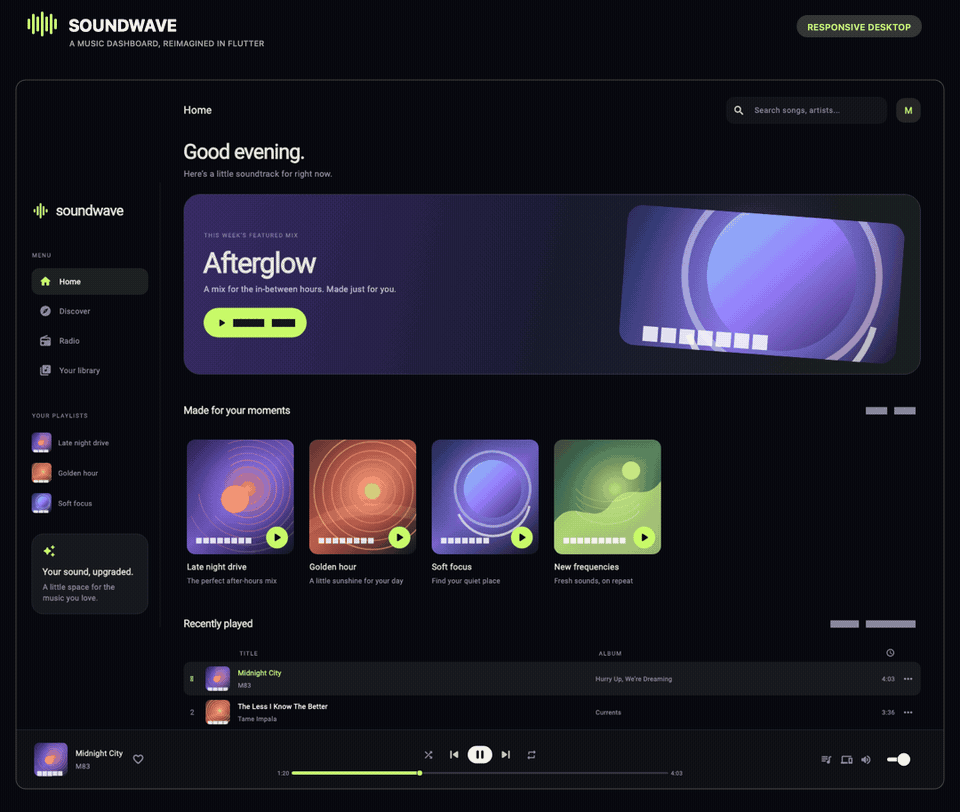
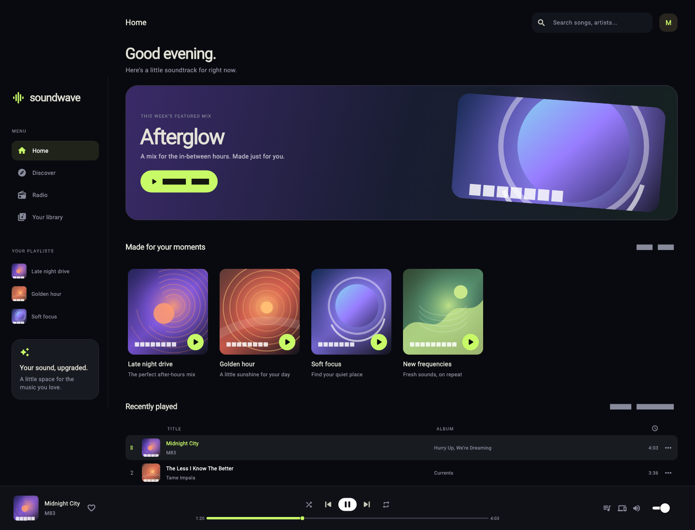
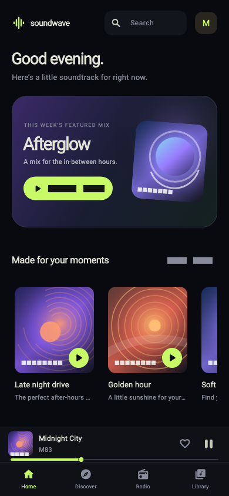

# Soundwave

<p align="center">
  
</p>

<p align="center">
  A responsive Flutter music dashboard with procedural artwork and an interactive local mock player.
</p>

Soundwave is a self-contained Flutter showcase for an immersive music-listening interface. It combines a dark, responsive Material 3 dashboard with custom album artwork, searchable mock content, and an interactive player. The project has no runtime third-party dependencies, external APIs, credentials, bundled music, or platform-specific services.

> **Scope:** Soundwave is a UI prototype, not a streaming or audio-playback client. Track data and player state are local, in-memory mocks.

## Features

- **Adaptive layouts:** A desktop sidebar and full playback dock at widths of 860 logical pixels and above; compact navigation and an inline mini-player below that breakpoint.
- **Featured mix:** A custom hero card with original, gradient-based artwork.
- **Four mock playlists:** _Late Night Drive_, _Golden Hour_, _Soft Focus_, and _New Frequencies_.
- **Search:** Filter sample tracks by title, artist, or album, and playlists by name. Empty queries restore the complete mock collection.
- **Mock playback controls:** Select tracks or mixes; play and pause; skip forward and backward; adjust the seek position and desktop volume; and toggle favorite, shuffle, and repeat states.
- **Procedural cover art:** Four bespoke illustrations—an orbital landscape, vinyl-inspired rings, a glowing planet, and layered hills—painted locally with Flutter's canvas APIs.
- **Responsive navigation:** Home, Discover, Radio, and Library selection states, presented in a mobile bottom bar or a desktop sidebar.
- **Screen-reader labels:** Player controls expose tooltips for their current actions.

### What the player does—and does not do

Playback is deliberately simulated. Play and pause change the displayed player state; next and previous step through the fixed mock track list; the seek slider is user-adjustable; and the volume slider is local UI state. The favorite marker is a transient player-level toggle rather than a per-track collection. Shuffle and repeat change their visual active states, but **do not** randomize tracks or implement audio repeat. There is no audio output, streaming, persistence, account, or backend integration.

Navigation selection is interactive, but all sections currently display the shared demo dashboard; this prototype does not implement separate Discover, Radio, or Library screens.

## Requirements

- A [Flutter SDK](https://docs.flutter.dev/get-started/install) and its bundled Dart SDK that satisfy the constraints in [`pubspec.yaml`](pubspec.yaml).
- A supported run target: Android, iOS, macOS, or a web browser.
- The Xcode toolchain to build or run iOS and macOS targets.

There are no separate runtime packages to install, API keys to configure, assets to download, or platform credentials to supply.

## Implementation overview

`lib/main.dart` intentionally keeps this small, dependency-free showcase in one Dart entry point:

- **`SoundwaveApp`** sets the dark Material 3 theme.
- **`MusicDashboard`** owns the immutable sample catalog and ephemeral UI state, derives search results, and selects the desktop or mobile scaffold with `LayoutBuilder`.
- **Private presentation widgets** compose the sidebar, header, hero, playlist cards, track rows, and responsive player.
- **`_Track` and `_Playlist`** are immutable, typed mock-data models.
- **`_AlbumArtwork` and `_ArtworkPainter`** draw all cover art at runtime with `CustomPainter`. A `RepaintBoundary` isolates these generated illustrations from surrounding dashboard repaints.
- **`test/widget_test.dart`** verifies the principal responsive layouts and player interactions.

No image assets are required to render the app; the PNG screenshots and animated GIF under `assets/images/` are documentation previews only.

## Project structure

```text
.
├── android/             # Android runner
├── ios/                 # iOS runner
├── macos/               # macOS runner
├── web/                 # Browser entry point and PWA metadata
├── assets/
│   └── images/          # README previews; not bundled into the app
├── lib/
│   └── main.dart        # App, mock catalog, UI state, and artwork painter
├── test/
│   └── widget_test.dart # Responsive and interaction widget tests
├── analysis_options.yaml
└── pubspec.yaml
```

## Preview images

The README animation and static captures are generated from real Flutter widget-test renders. They require no network access and are not loaded by the running application.

<p align="center">
  
  &nbsp;
  
</p>

---

**Soundwave** — a visual Flutter prototype. Replace the local sample catalog and simulated controls with your preferred media, persistence, and audio services when extending it into a production player.
